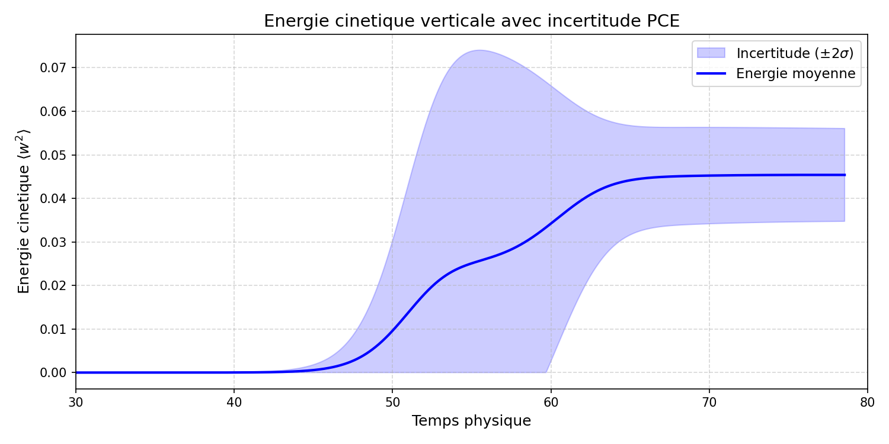
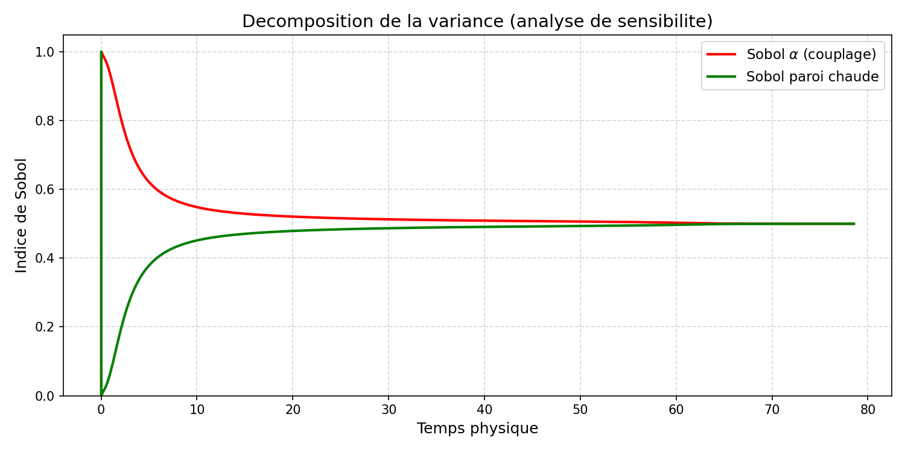
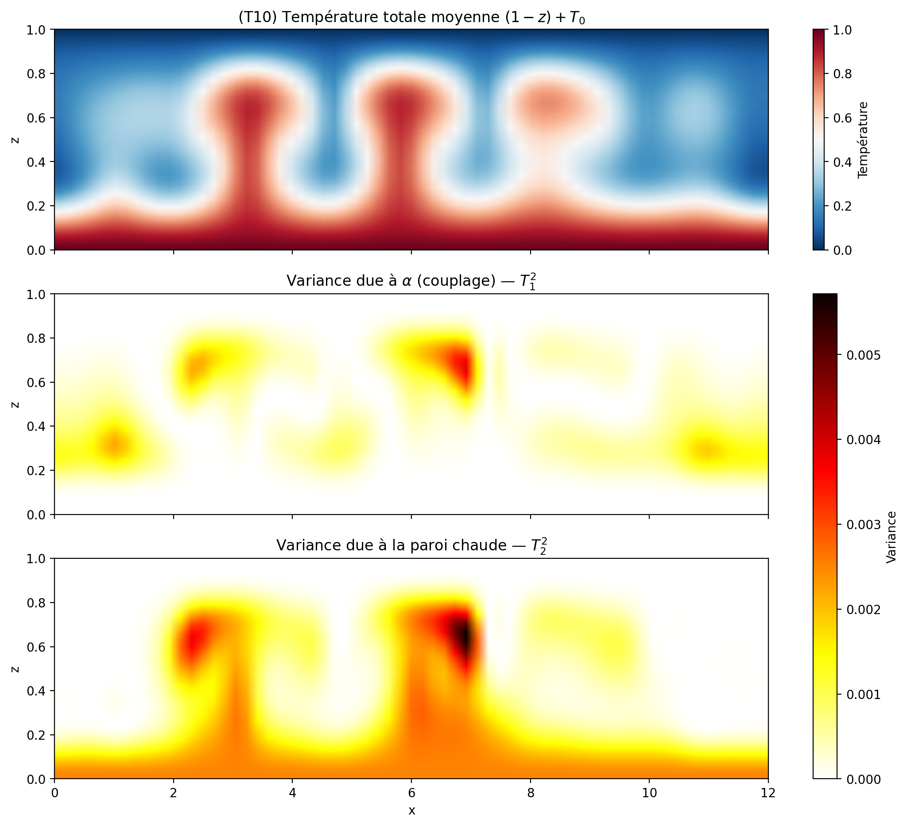

# Analyse de sensibilité paramétrique par polynômes du chaos intrusifs dans un modèle CFD

En simulation numérique de la mécanique des fluides, les données d'entrée (propriétés du fluide, conditions aux limites, paramètres de forçage) sont rarement connues avec certitude. Ces incertitudes se propagent au cours du calcul et affectent directement la fiabilité des résultats.

Ce projet implémente une méthode de développement en polynômes du chaos (PCE) intrusif reposant sur la projection de Galerkin stochastique au sein du solveur spectral Tchebycube. Contrairement à l'approche classique de Monte-Carlo, dont la convergence lente rend le coût prohibitif pour les solveurs fluides, cette méthode intrusive modifie directement les équations gouvernantes pour capturer fidèlement les effets non linéaires et propager l'incertitude de manière hautement efficace.

## Fonctionnalités et apports

*   **Analyse de sensibilité analytique :** Extraction des moments statistiques (espérance, variance) et des indices de Sobol globaux directement à partir des coefficients spectraux calculés, offrant une analyse de sensibilité pour un coût de calcul quasi nul.
*   **Évaluation multi-paramètres :** Modélisation de la convection de Rayleigh-Bénard incluant simultanément plusieurs paramètres incertains indépendants (couplage thermique et température de paroi chaude) afin de hiérarchiser l'influence de chaque source.

## Aperçu Visuel

## Structure du Projet

*   **`PCE_Barre_chauffee/PCE_EF_1D_barre_chauffee.py`** : Preuve de concept autonome appliquant le chaos polynomial intrusif à l'équation de Poisson 1D discrétisée par éléments finis.
*   **`src/rrb_pce_alpha_paroi.f90`** : Module CFD (Fortran 90) modélisant la propagation d'incertitude sur deux paramètres incertains (flottabilité et condition aux limites thermique), intégrant le calcul analytique de la variance et l'extraction des indices de Sobol.
*   **`Rapport.pdf`** : Rapport de recherche complet détaillant la formulation mathématique de la projection de Galerkin et l'analyse physique des résultats.

## Contexte d'Intégration et Délimitation du Code

*   **Modèle 1D autonome (Python) :** Le script `PCE_EF_1D_barre_chauffee.py` est développé intégralement pour visualiser le comportement de la méthode intrusive (Exécution via `python PCE_Barre_chauffee/PCE_EF_1D_barre_chauffee.py`, requiert `numpy` et `matplotlib`).
*   **Module CFD (Fortran 90) :** Le fichier rrb_pce_alpha_paroi.f90 illustre la traduction de ma modélisation mathématique en code de calcul. J'ai conçu la logique du problème (projection de Galerkin, dédoublement modal, recombinaison algébrique des termes non linéaires) et utilisé l'IA comme assistant de programmation pour générer la syntaxe Fortran 90 au sein de l'architecture MPI du solveur académique Tchebycube. Cette démarche m'a permis d'intégrer des concepts stochastiques avancés dans un environnement HPC sans altérer le cœur numérique préexistant (non fourni ici par respect pour la propriété intellectuelle du laboratoire).